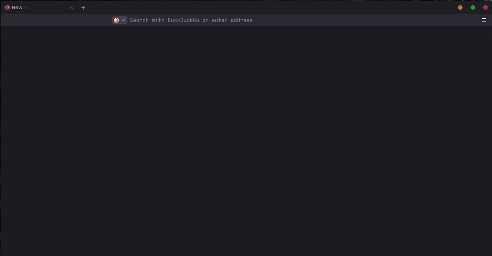

# Firefox Minimal Theme

A clean, minimalist Firefox theme that turns the browser UI into a transparent, distraction-free interface using `userChrome.css`.



## Features

**Interface**
- Square tabs with no rounded corners 
- Window controls and back/forward buttons hidden  
- Address bar icons hidden until hover  

**Tabs**
- Character-based title truncation 
- Same transparent background for active and inactive tabs  

**Typography**
- JetBrains Mono by default  
- Cross-platform monospace fallback stack  
- Consistent font usage across the UI  

**Interaction & Polish**
- Tab close buttons appear on hover  
- Smooth 0.25s transitions  
- Accessible but minimal extension button  
- High-DPI and responsive layout support  


## Installation

### 1. Enable userChrome.css
- Open `about:config`
- Enable `toolkit.legacyUserProfileCustomizations.stylesheets`


### 2. Install
- Open `about:profiles`
- Open your active profile’s root directory
- Create `chrome/` if missing
- Place `userChrome.css` inside it
- Restart Firefox

### File Structure
```
Firefox Profile/
└── chrome/
    └── userChrome.css
```

## Customization

### Extension Button Sizing
Adjust the extension button width for your preference:

```css
:root {
    --extension-button-width: 12px; /* Default: 12px */
}
```

**Size Guidelines:**
- `8px` = Minimal (harder to click)
- `12px` = Balanced (default)
- `16px` = More accessible
- `20px` = Maximum visibility

### Animation Timing
Customize transition speeds throughout the interface:

```css
:root {
    --transition-duration: 0.25s; /* Default speed */
    --transition-easing: ease-out; /* Default easing */
}
```

### Font Customization
Change the monospace font by modifying the CSS variable:

```css
:root {
    --mono-font-stack: 'Your Preferred Font', ui-monospace, 'SF Mono', Consolas, monospace;
}
```
## Fonts

JetBrains Mono is recommended for best readability.  
Available via official download or common package managers on Windows, macOS, and Linux.

## Color Themes

This theme works well with:
- Firefox Color for custom browser colors
- Catppuccin for Firefox (Latte, Frappé, Macchiato, Mocha)

Both layer cleanly on top of `userChrome.css`.

## Recommended Add-ons

Enhance the minimal experience with these complementary extensions:

- **[OS Style Close Window Button](https://addons.mozilla.org/en-US/firefox/addon/os-style-close-window-button/)** - OS style toolbar button to close current window
- **[OS Style Minimize Window Button](https://addons.mozilla.org/en-US/firefox/addon/os-style-minimze-window-button/)** - OS style toolbar button to minimize current window
- **[OS Style Maximize Window Button](https://addons.mozilla.org/en-US/firefox/addon/os-style-maxmize-window-button/)** - OS style toolbar button to maximize current window
- **[BetterFox](https://github.com/yokoffing/BetterFox)** - Performance and privacy optimizations

### Extensions Menu Access
The extensions button is now more accessible with a 12px width and subtle hover effects. **Hover over the extension button area** (right side of the toolbar) to see it clearly and access your extensions dropdown. The button maintains the minimal aesthetic while being much more user-friendly than before.

## Notes

- This theme relies on Firefox's legacy user stylesheet feature
- Some UI elements are intentionally hidden for a minimal aesthetic
- Window controls can be restored using the recommended add-ons
- Future Firefox updates may affect compatibility
---
